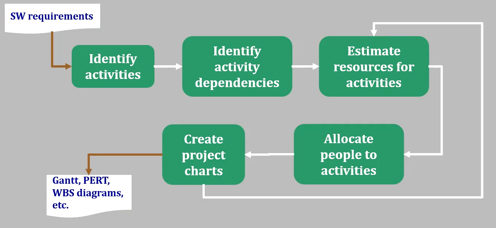
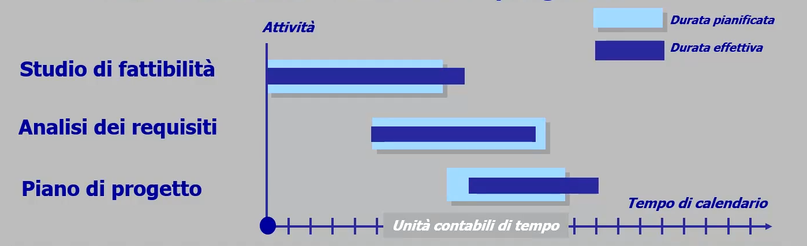
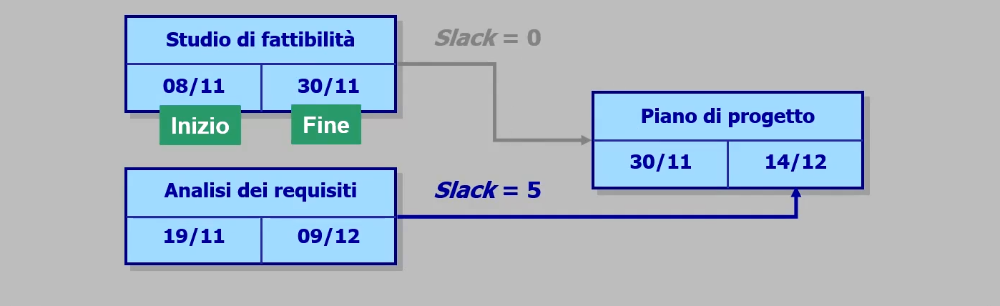
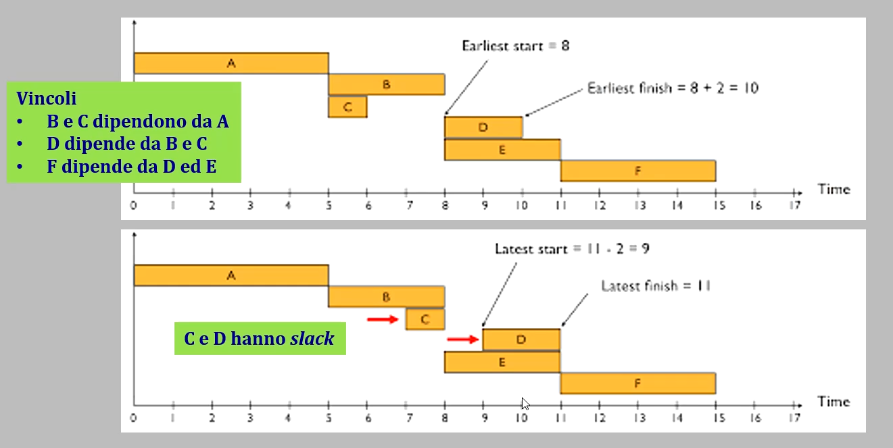
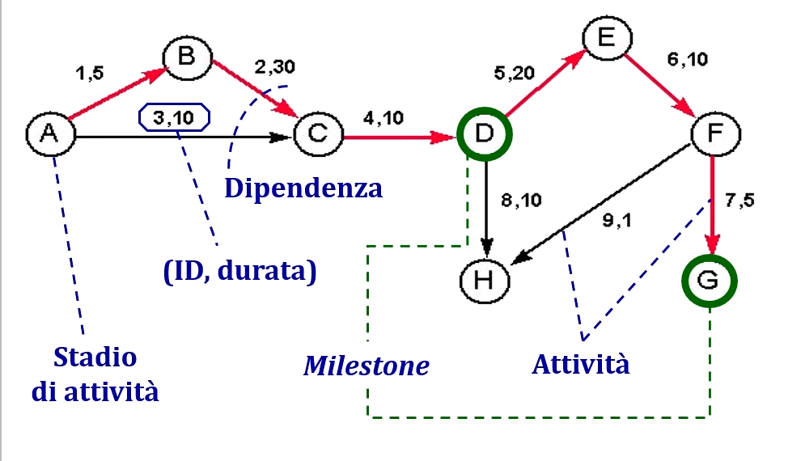
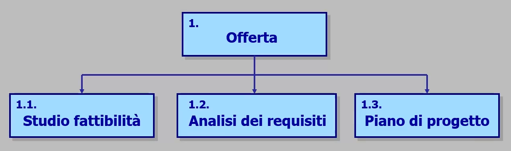
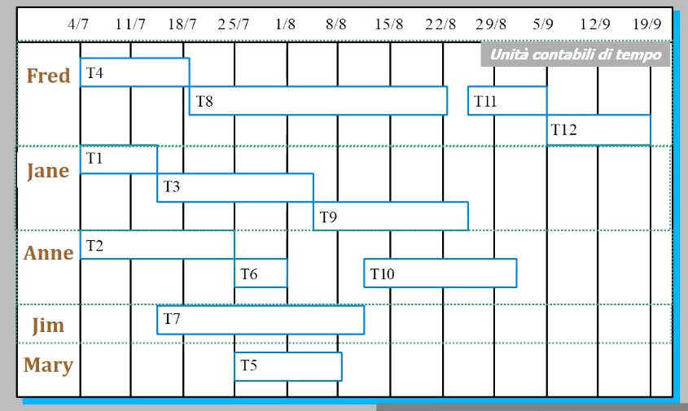
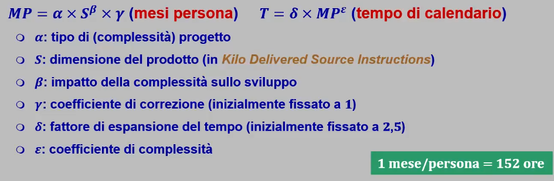

# T4: Gestione di progetto

## Cos'è un progetto?

Ora sappiamo che un progetto è un insieme ordinato di attività che istanziano processi di ciclo di vita:
- le attività sono fatte di compiti assegnati a singoli individui;
- il progetto nel suo complesso è sempre collaborativo;

Le attività sono pianificate *prima* di essere svolte, ognuna ha specifici obiettivi e vincoli che derivano dal loro processo e deve puntare all'economicità.

## Fondamenti di gestione

I passaggi sono, in ordine:

1. Determinare i processi generali da istanziare nel *way of working*;
2. Stimare le risorse necessarie per svolgere le attività di progetto (raportandole sempre alle risorse disponibili);
3. Pianificare le attività e assegnarle alle persone (a partire dall'obiettivo "all'indietro");
4. Controllare le attività verificandone i risultati:
    - il più frequentemente possibile ("push", non "pull");
    - aggiornando la pianificazione alla luce dell'avanzamento;

### Ruoli e funzioni

In una organizzazione il personale è raggrupato per funzioni:
- Direzione;
- Amministrazione finanziaria;
- Sviluppo;
- Controllo di qualità;
- ...

In un progetto le persone assumono **ruoli** ed ogni ruolo assume responsabilità (ownership) su specifiche attività di specifici processi.
 
### Ruoli

Analisti:
- Conoscono il dominio del problema e hanno esperienza professionale;
- Hanno molta influenza sul successo del progetto;
- Sono pochi e non seguono il progetto fino alla consegna;

Progettisti:
- Hanno competenze tecniche e tecnologiche aggiornate;
- Influisocno sulle scelte tecniche e tecnologiche;
- Sono pochi e seguono lo sviluppo ma non la manutenzione;

Programmatori:
- Parecipano alla realizzazione e manutenzione del prodotto;
- Hanno competenze tecniche, ma autonomia e responsabilità circoscritte;
- Formano la categoria storicamente più popolosa;

Verificatori:
- Sono presenti per l'intera durata del progetto;
- Hanno competenze tecniche, esperienza professionale e conoscenza del *way of working*
- Hanno capacità di giudizio e di relazione;

Responsabile:
- Governa il *team* e rapresenta il progeto verso l'esterno:
    - accentra le responsabilità di scelta e approvazione;
    - partecipa al progetto per tutta la sua durata;

- Ha responsabilità su:
    - pianificazione;
    - gestione delle risorse umane;
    - controllo, coordinamento e relazioni esterne;
- Deve avere conoscenze e capacità tecniche per valutare rischi, scelte e alternative.

Amministratore:
- Ha controllo sull'ambiente di lavoro:
    - amministrazione delle infrastrutture di supporto;
    - risoluzione di problemi legati alla gestione dei processi;
    - salvaguardia della documentazione di progetto;
    - controllo di versioni e configuazioni;

## Gestione qualità

E' la funzione di più recente introduzione ma rimane una funzione aziendale e non un ruolo di progetto.

La **qualità** ha più dimensioni:
- riguarda i prodotti e i processi;
- interessa sia il committente che la direzione aziendale;

La garanzia di qualità produce confidenza perchè richiede applicaizone rigorosa dei processi adottati e la loro manutenzione migliorativa (ciclo PDCA)

## Pianificazione di progetto

Il primo step è la *definizione delle attività* per pianificare lo svolgimento e valutare il progresso per avere un base su cui gestire l'allocazione delle risorse e stimare scadenze e costi.

Alcuni strumenti per la pianificazione:
- Diagrammi di Gantt;
- Programme Evaluation and Review Technique (PERT);
- Work Breakdown Structure (WBS);

### Diagrammi di Gantt

Dislocazione temporale delle attività per:
- rappresentare la durata;
- rappresentare la sequenzialità e parallelismo;
- confrontare le stime con i progressi;

Di seguito un esempio di diagramma di Gantt:

### Diagrammi PERT

Il diagramma PERT riporta le dipendenze temporali tra le attività per ragionare (all'indietro sulle scedenze di progetto).

Introduce il concetto di *slack time* cioè il tempo che intercorre tra la fine di una attività con precedenza su un'altra e l'inizio di quella successiva.

Lo *slack* si basa sul concetto di **cammino critico**: sequenza di attvità ordinata con prodotto importante e dipendenze temporale strette.

Ora vediamo un esempio pratico di diagramma PERT, evidenziando in rosso il **cammino critico**:

**Milestones**: punto del calendario che sia significativo per la pianificazione;

### Work Breakdown Structure

La Work Breakdown Structure è una struttura gerarchi delle attività in cui ogni attività si compone di sottoattività (non necessariamente sequenziali) univocamente identificate.

## Allocazione delle risorse

L'operazione di allocazione delle risorse significa assegnare attività a ruole e ruoli a persone.

La difficoltà è riuscire a farlo senza sottostimare o sovrastimare.

## Stima dei costi di progetto

La pianificazione dei costi si divide in 3 componenti:
- strumenti che permettano di organizzare le attività;
- strumenti che permettano di evidenziare le criticità;
- strumenti che permettano di studiare scenari;

Per definirne la durata ed il costo si calcola il **tempo/persona** stimato necessario e rapportandolo al tempo di calendario.

Questa stima si puo' fare per esperienza, analogia, competizione, tramite algoritmo predittivo o per raffinamenti; \
ovviamente useremo una grana grossa sull'insieme ma passando ad una grana fine per periodi brevi.

### Fattori di influenza sulle stime

- Dimensione del progetto;
- Esperienza del dominio;
- Familiarità con le tecnlogie;
- Produttività dell'ambiente lavorativo;
- Qualità attesa;

### Modello algoritmico 

Un esempio di modello algoritmico per la previsione delle risorse è il *CoCoMo* o *Constructive Cost Model* che stima le risorse necessarie esprimendone la misura in mesi/persona;

La formula per il calcolo è la seguente:

Assume un modello di sviluppo sequenziale da zero e fornisce alcune linee guida generali in base alla complessità:
- Bassa complessità: 

1.04.38