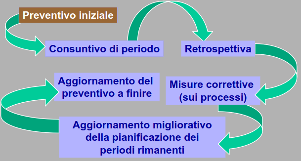
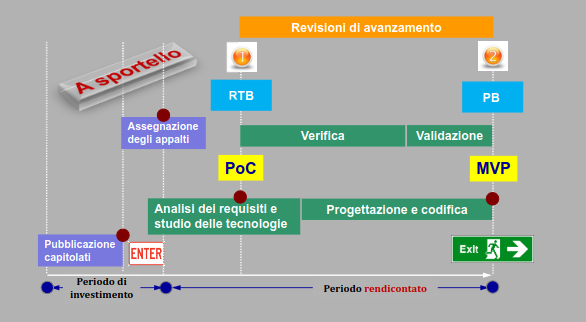

# PD2: Regolamento del progetto 

## Piano di progetto

Durante la candidatura verrà presentato un preventivo iniziale, contentente:
1. Rischi attesi e loro mitigazione;
2. Calendario di massima del progetto;
3. Impegno orario previsto (a persona e per ruolo) e stima dei costi totali;

Avverrà poi la suddivisione del lavoro in periodo di avanzamento.

Un consuntivo (parziale) per ogni periodo che prende il nome di **consuntivo di periodo**:
- avanzamento atteso vs avanzamento conseguito;
- rischi occorsi, impatto e mitigazione;
- costi attesi vs costi reali vs avanzamento;

Un aggionramneto di preventivo residuo ad ogni fine periodo che prende il nome **preventivo a finire**:
- retrospettiva di periodo come migliorare in futuro;
- Revisione calendario rimanente e aggiornamento stima dei costi finali;

## Piano di qualifica 

Specifica degli obiettivi quantitativi di qualità di prodotto e di processo (*way of working*)

Misurazione del raggiungimento di tali obiettivi allo stato corrente tramite **cruscotto di valutazione della qualità**;

Retrospettivi ed iniziative di automiglioramento:
- lista TODO;
- scadende / obiettivi.

## Revisioni di avanzamento 

Le revisioni avvengono in due momenti distinti, la prima è circa a metà delle 20 settimane mentre la seconda è progetto finito.

Le due fasi di revisioni sono le seguenti:

1. Revisione #1. **Requirements and Technology Baseline** (**RTB**): 
    - in due parti (Cardin -> Vardanega) 
    - il superamento della revisione sempre richiede modifiche e correzioni;
        1. Fissa i requisiti da soddisfare in accordo con il proponente nel documento **Analisi dei Requisiti**;
        2. Motiva le tecnologie e i *framework*, le librerie adottate, e ne dimostra adeguatezza e interoperabilità tramite **POC** posto in repo accessibie a committente e proponente;
        3. POC e AR passano al vaglio del docente Cardin entro specifiche finestre di opportunità;
        4. Chiude con preesentazione al docente Vardanega solo dopo "semaforo verde" al passo precedente;
2. Revisione #2. **Product Baseline** (**PB**):
    - in due parti (Cardin -> Vardanega)
    - tra la prima e la seconda parte, il gruppo espone la propria B al proponente e ne ottiene la valutazione di **MVP**;
        1. Vaglia la maturità della baseline architetturale del prodotto SW e la sua realizzazione (*product baseline*):
            - Design definitivo, coerente con ma migliorativo rispetto al POC descritto nel documento **Specifica Tecnica**;
            - Avanzamneto sostanziale di codifica, verifica e validazione, che passa al vaglio del propoenente che lo valuta **Minimum Viable Product**;
        2. ST passa al vaglio del docente Cardin entro specifiche finestre di opportunità;
        3. Chiude con presentazione al docente Vardanega:
            - Esame del grado di raggiungimento obiettivi funzionali e di qualità;
            - Solo dopo "semaforo verde" al passo precedente;

Riporto di seguito lo scadenziario del progetto:

### POC, MVP e Specifica Tecnica
- **POC** (Proof of concept): 
    - realizzato a inizio progetto, è un artefatto usa-e-getta sul piano architetturale;
    - serve a valutare la *fattibilità tecnologica* del prodotto atteso rispetto a specifici sottoinsieme di funzionalità individuate con il proponente;
    - *baseline* tecnologica e non architetturale;
    - aiuta a consolidare l'analisi dei requisiti dal lato della soluzione;

- **MVP** (Minimum Viable Product): 
    - approssima da vicino il prodotto atteso senza essere finale e definitivo;
    - dotato di funzionalità sufficienti per:
        - valutare la bontà della visione iniziale di prodotto;
        - consentire agevole uso esplorativo;
        - prendere decisioni ben fondate per il completamento definitivo del prodotto;
    - offre "the *maximum* amount of *validated learning* about customers' needs with the *least* amount of effort";

- **Specifica Tecnica**:
    - l'architettura logica del prodotto, per componenti, ruoli, connessioni e interazioni;
    - l'architettura di *deployment*, cioè l'allocazione delle componenti architetturali nel sistema di esecuzione;
    - i *design pattern* architetturali utilizzati, e quelli determinati dalle tecnologie adottate;
    - gli *idiomi* (pattern di livello più basso che architetturale) eventualmente utilizzati;
    - ogni altro aspetto progettuale che valorizzi o caratterizzi il vostro *design*;

## Obblighi

### Obblighi documentali

Rientrano negli obblighi documentali:
1. Documenti gestionali esterni, aggiornati ad ogni periodo:
    - Piano di progetto;
    - Piano di qualifica;
2. Documenti gestionali interni:
    - Norme di progetto;
    - **Verbali**: breve rendiconto di riunini ufficiali (agenda, decisioni, azioni);
    - **Glossario**: spiega ogni termine specializzato del dominio di progetto;
3. Documenti tecnici esterni:
    - Analisi dei Requisiti;
    - Specifica Architetturale;
    - Manuale Utente;

Tutti devono essere posti in *repo* sotto controllo di versione, ogni documento con suo proprio **Registro delle Modifiche**.

### Obblighi procedurali

Tra gli obblighi procedurali rientra l'attività di relazionare sulla "situazione di gruppo" agli eventi **diario di bordo** secondo il calendario.

Candidarsi esplicitamente alle revisioni di avanzamento:
- quando il progresso effettivo soddisfa le ates della corrispondente *milestone*;
- esporre puntatotre a sezione repo dedicata alla revisione, includendovi una **Lettera di Presentazione** che elenca i contenuti della consegna e descrive brevemente lo stato di avanzamento.

La candidatura va fatta per posta elettronica *senza* invio di allegati!

### Obblighi operativi

Ogni gruppo deve dotarsi di:
- Nome;
- Logo;
- Riflettore di posta elettronica;
- Repo:
    - Software;
    - Documentale;

Ogni componente di gruppo fornitore deve ruotare su tutti i ruoli secondo regole documentate (time-based(?), task-based(?)), assumere ogni ruolo per un tempo totale congruo (equo(?)) e assumere NON più di un ruolo alla volta.

Le regole di rotazione devono assicurare assenza di conflitto di interessi garantendo verifica indipendente per ogni attività.